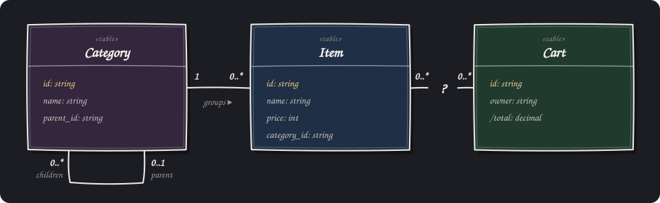

+++
title = "Vantage Deep Dive: Vista"
description = "Introducing the Vantage Deep Dive series. Today I'll tell you about Vista, one of the most fundamental concepts in Vantage's machinery."
date = 2026-11-02

[taxonomies]
categories = ["Engineering"]
series = ["Deep Dive"]
tags = ["rust", "orm", "sql", "nosql", "yaml", "rhai", "data abstraction"]

[extra]
cover = "cover.jpg"
hero = "hero.jpg"
hero_alt = "Romans, author of Vantage, sitting on a grassy hilltop at sunset, enjoying a typical view of Hertfordshire, UK from Pegsdon Hills."
hero_caption = "Scenery of Hertfordshire, UK from [Pegsdon Hills](https://en.wikipedia.org/wiki/Pegsdon_Hills_and_Hoo_Bit), my frequent cycling destination."
+++

When you build your app in Vantage UI, the LLM agent, informed by the skills, rushes to wire up your backend architecture in minutes. In this post I pause to explain why Vantage affords this efficiency, starting with the most fundamental concept in our toolkit: .

## Entities, Tables and Models



Vantage is a solution for business apps: it operates across a large number of different data records, which the industry refers to as entities. In some companies, the number of entities can run into several hundred. Without a well-defined framework to guide LLM-written code, the backend becomes a bowl of slop with thousands of hard-coded SQL queries.

Vista is the answer to this complexity. Vistas enable you and your LLM to define a complex database structure in minutes and have it visualised in Vantage UI as a series of pages and CRUD screens, making backend architecture transparent and scalable.

Not sure what should replace the `?` between `Item` and `Cart`? That's fine. In Vantage, a relation is easy to change later, and changing it doesn't ripple through the rest of your codebase.

## What is Vista?


1. **A table in the wild** A table, collection or dataset is a bulk of your data records sitting in a remote database. We assume that the records can change at any time, and that there is generally too much data to retrieve fully.
2. **A table in Vantage** The {{<glossary.term id="table_rust" code={true} />}} struct describes a remote collection of structured records without retrieving them. However, `Table<Sqlite, Item>` and `Table<Postgres, Item>` are different types, so code can't simply accept any table. Each table is also coupled with a data source: a driver responsible for communicating with the actual database.
3. **Vista: a shell for a table** {{<glossary.term id="vista_rust" code={true} />}} is a type-erasing container, a little like TypeScript's `any`, except that it still knows its columns and what its source can do. A Vista can be any table from any data source, keeping every feature its source supports.


Like a vast view that you observe from a peak after a gruelling climb, a Vista cannot be captured. It is always changing, and we can only work with part of it.

## Defining a Vista

There are three distinct ways to create a `Vista` in your application. First, it can be Rust code: create a `Table` and wrap it in a Vista shell. The second option is to define it as a YAML structure. The third is YAML with Rhai.


<div class="cols__col">

**Rust**

```rust
let item: Table<_, EmptyEntity> =
  Table::new("item", db.clone())
    .with_id_column("id")
    .with_column_of::<String>("name")
    .with_column_of::<i64>("price")
    .with_column_of::<String>(
      "category_id");

let vista = db
  .vista_factory()
  .from_table(item)?;
```

<p class="cols__tags"><span>requires compilation</span></p>

</div>

<div class="cols__col">

**YAML**

```yaml
name: item
columns:
  id: { type: string, flags: [id] }
  name: { type: string }
  price: { type: int }
  category_id: { type: string }
sqlite:
  table: item
```

<p class="cols__tags"><span>loads on demand</span></p>

</div>

<div class="cols__col">

**YAML + Rhai**

```yaml
name: category_path
columns:
  id: { type: string, flags: [id] }
  name: { type: string }
  path: { type: string }
postgres:
  rhai: |
    let path = `(WITH RECURSIVE
      up AS (
      SELECT name, parent_id, 0 AS d
      FROM category WHERE id = cat.id
      UNION ALL
      SELECT p.name, p.parent_id,
        up.d + 1 FROM category p
      JOIN up ON p.id = up.parent_id)
      SELECT string_agg(name, ' > '
        ORDER BY d DESC) FROM up)`;
    sql::select()
      .from_as("category", "cat")
      .field("id").field("name")
      .expression(sql::expr(path)
        .alias("path"))
```

<p class="cols__tags"><span>loads on demand</span><span>dynamic generation</span><span>read-only</span></p>

</div>


If you are a Rust developer, the open-source Vantage Framework is a clear path to defining your own tables and, if necessary, type-erasing them by placing them in a Vista shell.

However, in Vantage UI, changes to your data definition must be instant. Vantage UI and Vantage Server mirror the functionality in YAML and Rhai, including database-specific extensions.

## How does Vantage use Vista?

When Vantage UI builds your application, it works with UI widgets (tables, grids, lists, combo boxes) as well as API routes (REST, WebSocket, MCP). None of them has any knowledge of which database vendor you are using: move a table from SQLite to Postgres, and the pages and APIs above it don't change. They are all perfectly content with a single `Vista` instance, and here is what information they can extract:

1. [Structure](https://docs.rs/vantage-vista/latest/vantage_vista/struct.Vista.html#method.columns): columns, their types and flags.
2. [Capabilities](https://docs.rs/vantage-vista/latest/vantage_vista/struct.Vista.html#method.capabilities): can we sort, search, page through or watch for changes?
3. [Permissions](https://docs.rs/vantage-vista/latest/vantage_vista/struct.Vista.html#method.denials): can the source be written to, and do any rules forbid it?
4. [Data](https://docs.rs/vantage-vista/latest/vantage_vista/struct.Vista.html#method.list_values): specific records, or a list of them.
5. [Relations](https://docs.rs/vantage-vista/latest/vantage_vista/struct.Vista.html#method.get_ref): follow a reference to a related Vista, wherever it is stored.
6. [Narrowing](https://docs.rs/vantage-vista/latest/vantage_vista/struct.Vista.html#method.with_condition): filter, search, sort and page, without touching the original.
7. [Writes](https://docs.rs/vantage-vista/latest/vantage_vista/struct.Vista.html#method.insert_value): insert, update and delete, never landing outside the current view.
8. [Live changes](https://docs.rs/vantage-vista/latest/vantage_vista/struct.Vista.html#method.watch): updates pushed by the source, where it supports them.
9. [Refusal details](https://docs.rs/vantage-vista/latest/vantage_vista/enum.Capability.html): a clearly codified error when an action is refused.

## Conclusion

Vantage gives you two ways to build out your extensive data model without modifying your data structure or moving data into a different database: either through type-safe Rust code, or by using Vantage UI with YAML and Rhai. Both options cost you nothing:

1. [Download Vantage UI](@/download.md).
2. Grant access to your non-production database.
3. Have your LLM build out table definitions based on your existing physical structure.

This also builds all the data-editing pages for you automatically: you can observe data, traverse relations and define which columns you want to see, all in minutes.

To see Vistas at work, look at [Launch Control](@/examples/launch-control.md) and [unleash-vg](https://github.com/romaninsh/unleash-vg). Both use Vista to define the structure of their source data and present it in the UI. For how Vistas are defined in YAML specifically, browse the [table definitions of the Space example](https://github.com/romaninsh/vantage-ui-examples/tree/main/apps/space/table).

Once you're happy with your data model, you can define API endpoints, secure access and permissions, and define custom actions, but that will be my next deep dive.
